<div align="center">

<a href="https://omnifolio.app"></a>


<h3 align="left">Key Focus</h3>
<ul align="left">
  <li><b>OmniFolio</b>: financial intelligence for retail investors and analysts.</li>
  <li>SEC EDGAR, congressional trading, Senate lobbying, FRED macro and federal spending data in one terminal.</li>
  <li>Geopolitical OSINT, ship tracking and aircraft tracking on a unified map.</li>
  <li>AI Analyst grounded in primary-source filings.</li>
  <li>Cross-platform desktop apps built with Tauri.</li>
</ul>

<h3 align="left">Currently Building</h3>
<ul align="left">
  <li><b>Zeus</b>: multi-node agentic AI framework with Mnemosyne memory.</li>
  <li><b>OmniDesk</b>: every device screen, one unified computer.</li>
  <li><b>OmniStore</b>, <b>OmniBoost</b> and <b>OmniMix</b>.</li>
  <li>An Unreal Engine MMO inspired by Lineage 2.</li>
</ul>
<br />

<p><strong>
  Solo founder. Based in Greece.
  <br><br>
  Writing Aristotle's Academy on sport, markets and geopolitics 📈
</strong></p>

<a href="https://omnifolio.app"></a>
<a href="https://docs.omnifolio.app"></a>
<a href="https://github.com/Omnifolio-app"></a>


</div>

<hr>


```ts
const aristotle = {
  role: "Solo founder",
  company: "OmniFolio",
  base: "Greece",
  languages: ["TypeScript", "Python", "Rust", "Solidity"],
  speaks: ["English", "Mandarin"],
  data: ["SEC EDGAR", "Congress trades", "Senate lobbying", "FRED", "OSINT", "USAspending"],
  infra: ["GCP Cloud Run", "Cloudflare R2", "Upstash Redis", "Supabase", "Postgres + pgvector"],
  ai: ["OpenRouter", "DeepSeek", "GLM", "Qwen", "fal.ai"],
  desktop: ["Tauri", "React"],
};
```

-  &nbsp; Building **OmniFolio**, the Bloomberg Terminal for Everyone.
-  &nbsp; Running **Zeus** agents across a multi-node mesh.
-  &nbsp; Ask me about **SEC filings, congressional trades, macro data, agentic AI or Tauri**.
-  &nbsp; Fun fact: I speak Mandarin.

<div align="center">

**Code Cycle**<br>


&nbsp;&nbsp;&nbsp;&nbsp;&nbsp;

&nbsp;&nbsp;&nbsp;&nbsp;&nbsp;


<h1><a href="https://omnifolio.app">Tech Stack</a></h1>

<table align="center">
  <tr>
    <td align="center" width="90">
      
      <br>TypeScript
    </td>
    <td align="center" width="90">
      
      <br>Python
    </td>
    <td align="center" width="90">
      
      <br>Rust
    </td>
    <td align="center" width="90">
      
      <br>Solidity
    </td>
    <td align="center" width="90">
      
      <br>Bash
    </td>
    <td align="center" width="90">
      
      <br>React
    </td>
    <td align="center" width="90">
      
      <br>Next.js
    </td>
    <td align="center" width="90">
      
      <br>Tailwind
    </td>
    <td align="center" width="90">
      
      <br>Vite
    </td>
  </tr>
  <tr>
    <td align="center" width="90">
      
      <br>Node.js
    </td>
    <td align="center" width="90">
      
      <br>PostgreSQL
    </td>
    <td align="center" width="90">
      
      <br>Supabase
    </td>
    <td align="center" width="90">
      
      <br>Redis
    </td>
    <td align="center" width="90">
      
      <br>Docker
    </td>
    <td align="center" width="90">
      
      <br>GCP
    </td>
    <td align="center" width="90">
      
      <br>Cloudflare
    </td>
    <td align="center" width="90">
      
      <br>GH Actions
    </td>
    <td align="center" width="90">
      
      <br>Linux
    </td>
  </tr>
  <tr>
    <td align="center" width="90">
      
      <br>Tauri
    </td>
    <td align="center" width="90">
      
      <br>Capacitor
    </td>
    <td align="center" width="90">
      
      <br>Unreal
    </td>
    <td align="center" width="90">
      
      <br>Ethereum
    </td>
    <td align="center" width="90">
      
      <br>Solana
    </td>
    <td align="center" width="90">
      
      <br>Chainlink
    </td>
    <td align="center" width="90">
      
      <br>Stripe
    </td>
    <td align="center" width="90">
      
      <br>Playwright
    </td>
    <td align="center" width="90">
      
      <br>FFmpeg
    </td>
  </tr>
  <tr>
    <td align="center" width="90">
      
      <br>Claude
    </td>
    <td align="center" width="90">
      
      <br>DeepSeek
    </td>
    <td align="center" width="90">
      
      <br>Tailscale
    </td>
    <td align="center" width="90">
      
      <br>Discord
    </td>
    <td align="center" width="90">
      
      <br>Telegram
    </td>
    <td align="center" width="90">
      
      <br>Git
    </td>
    <td align="center" width="90">
      
      <br>GitHub
    </td>
    <td align="center" width="90">
      
      <br>Windows
    </td>
    <td align="center" width="90">
      
      <br>macOS
    </td>
  </tr>
</table>

<h3>Apps</h3>

| App | What it does | Get it |
|:--|:--|:--|
| **[OmniDesk](https://github.com/Aristotlev/omnidesk)** | All your device screens as one unified computer | [Download](https://github.com/Aristotlev/omnidesk#readme) |
| **[OmniStore](https://github.com/Aristotlev/omnistore)** | One dashboard for all your cloud and device storage | [Download](https://github.com/Aristotlev/omnistore#readme) |
| **[OmniBoost](https://github.com/Aristotlev/OmniBoost)** | Windows gaming and work performance optimizer | [Download](https://aristotlev.github.io/OmniBoost/) |
| **[OmniMix](https://github.com/Aristotlev/omnimix)** | Per-device equalizer and sound mixer | [Download](https://aristotlev.github.io/omnimix/) |
| **[Zeus](https://github.com/Aristotlev/ZEUS-FRAMEWORK)** | Open-source agentic AI framework | [Repo](https://github.com/Aristotlev/ZEUS-FRAMEWORK) |

<p align="center">
  <a href="https://github.com/Aristotlev?tab=repositories"></a>
  <a href="https://github.com/Aristotlev?tab=repositories"></a>
</p>

<p align="center">
  
</p>

</div>
